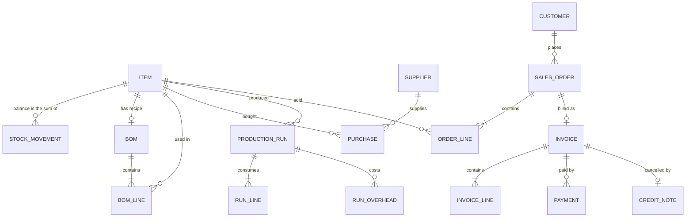

# Design note

## 1. Data model

`STOCK_MOVEMENT` rows carry a `source_ref` (for example `Purchase #1`, `Production run #1`, `INV/2026-27/0001`), so every movement traces back to its document. An `AUDIT_LOG` table records who created, changed or deleted the key records.

## 2. How stock is computed

- One table, `StockMovement`: item, signed quantity (plus in, minus out), movement type, source document, user and time. Types are opening, purchase, production issue, production output, wastage, dispatch and adjustment.
- **A balance is never stored.** It is `SUM(quantity)` over the item's rows, so it cannot drift from the ledger.
- Rows are never edited or deleted. A mistake is corrected with a new adjustment row.
- The stock summary shows opening + receipts - issues = closing for any date range.
- **Free stock** of a finished product = ledger balance minus what approved, not yet dispatched orders have claimed. Approval is blocked when an order exceeds free stock.

## 3. BOM consumption and variance

- A BOM lists, per batch, the quantity of each raw and packaging item, and the expected yield in packets.
- A run records batches, good packets, and for each material the quantity used and the quantity wasted.
- **Planned** = batches x BOM quantity. **Consumed** = used + wasted.
- **Variance %** = (consumed - planned) / planned x 100. Yield variance = (good - expected) / expected x 100.
- A variance beyond 3% either way is flagged (one constant, `VARIANCE_TOLERANCE`).
- Saving a run is one transaction: materials out, wastage out, packets in, variances stored. Nothing is saved if any step fails, and a run cannot use more than is in stock.
- Benchmark: flour 40 of 40 planned (0%), oil 10.5 of 10 (+5%, flagged), pouches 188 + 6 damaged = 194 of 200 (-3%, not beyond the limit), cartons 9 of 10 (-10%, flagged), yield 188 of 200 (-6%, flagged).

## 4. Costing and valuation

- **Method: weighted average.** Opening stock and each purchase are blended in time order, and issues leave the average unchanged. Flour: (100 kg x 42 + 60 kg x 45) / 160 kg = Rs 43.125 per kg.
- **Why:** the flour price moved from 42 to 45. Last price would charge 45 for stock that mostly cost 42. FIFO needs lot tracking for every receipt, which this prototype does not have.
- **Overheads** (labour, gas, power, other) are recorded against the run they belong to. They are not shared across runs.
- **Cost per packet** = (materials consumed, damaged included + overheads) / good packets.
- Benchmark: materials 1,725.00 + 1,470.00 + 240.00 + 485.00 + 135.00 = 4,055.00; overheads 1,800.00; total 5,855.00; 5,855.00 / 188 = Rs 31.14. Selling price 50.00, so margin Rs 18.86 (37.71%).
- **Known limit:** opening stock is valued at the item's current rate, so changing that rate would change old costs.

## 5. GST, invoices and credit notes

- Tax is calculated per line and rounded half-up to the paisa with `Decimal`.
- Customer state equal to the factory state (Tamil Nadu): CGST and SGST, each half the rate. Any other state: IGST at the full rate.
- Invoice numbers are `INV/<financial year>/<sequence>`, the year running April to March, with a unique constraint on year and sequence.
- Customer name, GSTIN and place of supply are copied onto the invoice, so later edits cannot change it.
- A posted invoice is never edited or deleted. A credit note (`CN/<year>/<sequence>`) reverses it in full, and can put returned goods back into stock through the ledger.

## 6. Audit trail

Django signals compare each tracked record before and after every save, and write one row with the user, the time and the old and new values (for example `rate: 50.00 -> 55.00`). A save that changes nothing writes nothing. Invoices and production runs are not editable at all, so their creation, dispatch and cancellation are what is logged.